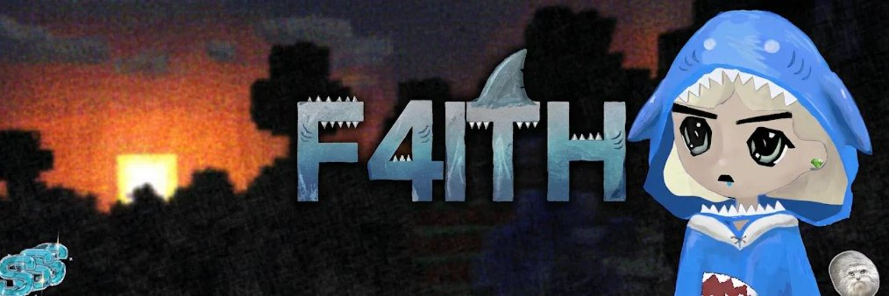
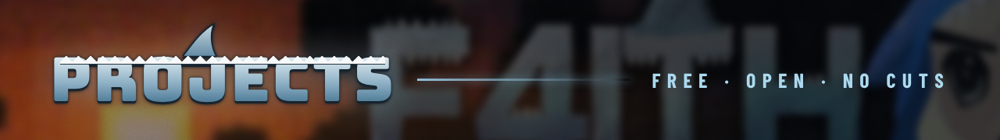
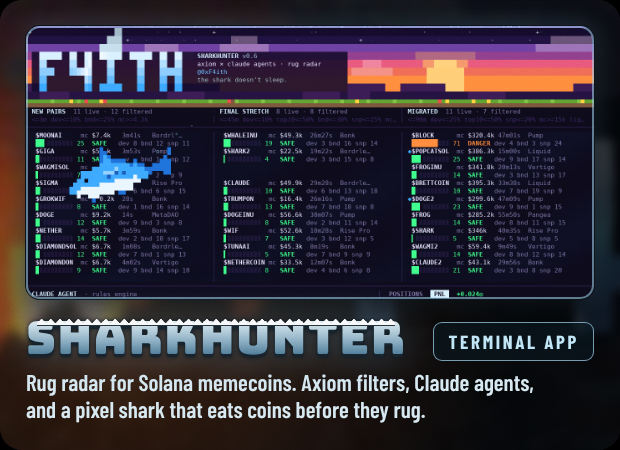
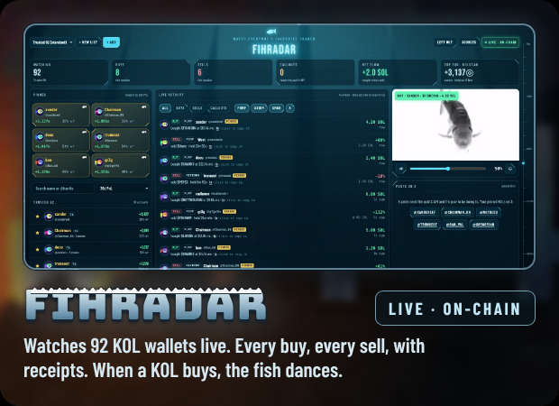
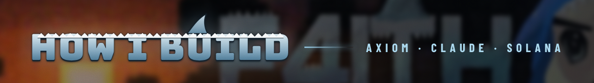
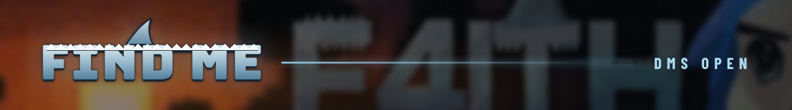

  

  <b>terminal apps for the trenches. free, open, nobody taking a cut.</b> 
  
  
  

<h3 align="center">I am F4ith and I build autistic tools that should be useful.</h3>

<table>
  <tr>
    <td width="50%" valign="top">
      
       <b><a href="https://github.com/0xF4ith/SharkHunter">SharkHunter</a></b>: terminal rug radar for Solana memecoins. Your Axiom presets feed it, Claude agents score every coin, and the pixel shark eats anything that's about to rug.
    </td>
    <td width="50%" valign="top">
      
       <b><a href="https://github.com/0xF4ith/FihRadar">FihRadar</a></b>: watches 92 trusted KOL wallets live. Every buy and sell straight off Solana, with profit, hold time and a Solscan link. When a KOL buys, the funky town fish dances.
    </td>
  </tr>
</table>

<h3 align="center">Smoke I get idea I do it</h3>

  new drops, trailers and dumb trench takes on X: <a href="https://x.com/0xF4ith"><b>@0xF4ith</b></a>

